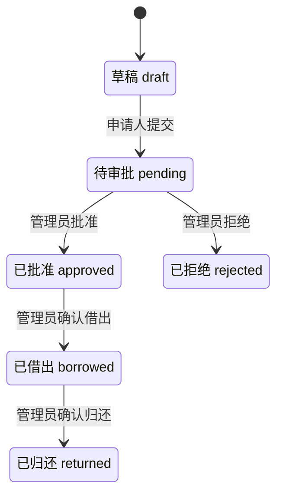

# 企业内部设备借用与审批管理系统

Equipment Borrowing & Approval Management 是一个基于 **Odoo 19 Community** 的独立业务模块，用于管理共享设备从申请、审批到借出、归还的过程。

员工提交自己的借用申请，设备管理员处理审批和交接。界面使用 Odoo 原生 XML Views；身份认证、ORM 和基础 Web 界面由 Odoo 提供，设备模型、申请模型、权限规则、审批逻辑和中文翻译由本模块实现。

源码仓库：[leoh4mster/odoo-equipment-borrowing](https://github.com/leoh4mster/odoo-equipment-borrowing)。

## 版本与依赖

| 项目 | 当前版本或要求 |
| --- | --- |
| Odoo | Community 19.0 |
| 模块 | `equipment_borrowing`，`19.0.1.5.0` |
| 本次验证环境 | Apple Silicon macOS、Python 3.12.14、PostgreSQL 16.15 |
| Odoo 源码版本 | `4ff91465babd9f88620d78d9db34c75b71fc0006` |
| 模块依赖 | `base`，无额外 Python 包或第三方业务模块 |
| 界面语言 | 简体中文、英文 |
| 许可证 | [LGPL-3.0](LICENSE) |

本模块使用 Odoo 19 的 `models.Constraint`、`models.UniqueIndex` 和 `<list>` 视图。其他 Odoo 主版本尚未验证。

## 已实现的功能

- 设备管理：名称、唯一编号、类别、描述、启用与归档，以及关联借用记录。
- 借用申请：自动编号、当前登录用户作为申请人、计划日期校验。
- 审批流程：提交、批准、拒绝、确认借出、确认归还。
- 权限控制：普通员工只处理自己的申请；设备管理员查看全部申请并执行审批和交接。
- 设备占用保护：同一设备最多存在一条“已批准”或“已借出”的申请；数据库唯一索引防止并发批准冲突。
- 界面完善：待审批记录加粗并着色，状态使用不同颜色的标签，管理员有独立“待审批”入口。
- 中文翻译：菜单、字段、按钮、状态及业务报错共 64 条翻译文本。

## 业务流程



“已批准”和“已借出”均占用设备，确认归还后释放占用。草稿、待审批、已拒绝和已归还不占用设备。

| 操作 | 普通员工 | 设备管理员 |
| --- | --- | --- |
| 查看设备 | 可以 | 可以 |
| 新增、修改、归档设备 | 不可以 | 可以 |
| 创建申请 | 为自己创建 | 为自己创建 |
| 查看申请 | 仅自己的申请 | 全部申请 |
| 编辑申请内容 | 自己的草稿 | 任意草稿 |
| 提交审批 | 自己的草稿 | 自己的草稿 |
| 批准、拒绝、借出、归还 | 不可以 | 按当前状态操作 |
| 永久删除设备或申请 | 不可以 | 不可以 |

权限在服务端检查。隐藏按钮是交互提示，不能替代访问权限、记录规则和业务方法中的校验。

## 安装与运行

需要一个能够运行的 Odoo 19 Community 环境。将本仓库的 `addons` 目录加入 `addons_path`，重启 Odoo 并安装 `equipment_borrowing`。

完整说明见 [安装与运行](docs/INSTALL.md)，其中区分了当前开发机和其他人的安装方式。`dev.sh` 依赖当前工作区的运行环境，不是通用安装器。

安装包不附带数据库、登录密码或预置账号；新环境的角色配置和操作步骤见 [使用说明](docs/USAGE.md)。

## 使用与验证

建议按以下顺序查看：

1. 阅读本文，确认功能范围和业务规则。
2. 按 [安装说明](docs/INSTALL.md) 安装模块。
3. 按 [使用说明](docs/USAGE.md) 操作设备管理、借用申请、审批和归还，检查角色差异与占用约束。
4. 阅读 [技术说明](docs/TECHNICAL.md)，定位模型、XML 视图、权限和并发保护代码。
5. 查看 [验证记录与复现方法](docs/VALIDATION.md)。

2026-11-25，当前版本在全新隔离数据库中安装成功，模块的 **44 项 Odoo 自动化测试通过，0 失败、0 错误**。独立事务并发检查及中英文接口校验的结果与边界见验证文档。

## 当前范围与限制

- 设备按单台实物管理，不提供库存数量或耗材管理。
- 使用“批准即占用，归还后释放”的简化规则，尚未按计划日期计算预约区间冲突。
- 提交后的申请内容冻结；暂未提供撤回、取消批准、驳回后重新提交等操作，可重新创建申请。
- 日期字段表示计划日期，尚未记录独立的实际借出时间和实际归还时间。
- 设备管理员可以审批自己的申请，尚未实现申请人与审批人必须不同的制度。
- 面向单公司场景，尚未实现多公司数据隔离、邮件通知、完整审批操作日志或超期提醒。
- Owl 数据看板属于后续可选扩展，当前版本未实现。

本项目已完成核心借用审批流程的开发和本地验证，尚未开展生产部署和压力测试。

## 目录

```text
equipment-borrowing/
├── addons/equipment_borrowing/
│   ├── __manifest__.py       # 版本、依赖和数据加载顺序
│   ├── models/               # 设备、借用申请和服务端业务规则
│   ├── views/                # 列表、表单、搜索、动作和菜单
│   ├── security/             # 用户组、ACL 和记录规则
│   ├── data/                 # 申请编号序列
│   ├── i18n/                 # 翻译模板和简体中文翻译
│   └── tests/                # 44 项 Odoo 测试
├── config/odoo.conf.example   # 外部安装使用的配置模板
├── docs/                     # 安装、使用、技术说明和验证记录
├── scripts/                  # 独立测试数据库中的并发检查
├── dev.sh / dev.py            # 当前工作区的本地进程管理工具
├── environment.json          # 本次环境版本与源码校验信息
├── environment-check.json    # 环境搭建阶段的验收快照
└── requirements-macos-py312.lock.txt
```

`local/` 用于保存本机配置和账号，已被 Git 忽略。运行环境、数据库文件和 Odoo 官方源码位于当前工作区的 `work/`，不属于模块源码，也不包含在交付压缩包中。

## 参考资料

- [Odoo 19 源码安装](https://www.odoo.com/documentation/19.0/administration/on_premise/source.html)
- [Odoo 19 命令行工具](https://www.odoo.com/documentation/19.0/developer/reference/cli.html)
- [Odoo 19 ORM](https://www.odoo.com/documentation/19.0/developer/reference/backend/orm.html)
- [Odoo 19 权限机制](https://www.odoo.com/documentation/19.0/developer/reference/backend/security.html)
- [Odoo 19 测试](https://www.odoo.com/documentation/19.0/developer/reference/backend/testing.html)
