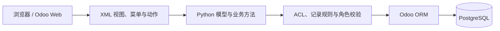

# 技术架构与实现

## 1. 代码与框架的分工

浏览器通过 Odoo Web 发起操作，Odoo 根据 XML 视图构造列表和表单，再调用 ORM 或模型方法。数据库保存记录并执行最终的唯一性约束。



图中是职责关系；实际访问检查会在查询、写入和业务方法中按需执行，不是一个独立中间件。

模型定义参与数据库结构和界面元数据的生成；审批操作由模型上的业务方法实现。基础 CRUD 使用 Odoo 标准接口，用户通过 Odoo 登录会话进行身份认证。

## 2. 模块如何加载

| 文件 | 作用 |
| --- | --- |
| `__manifest__.py` | 声明模块版本、依赖和 XML/CSV 文件加载顺序 |
| 模块根目录 `__init__.py` | 导入 `models` 包，使 Odoo 注册模型 |
| `models/__init__.py` | 导入设备与申请模型文件 |
| `security/equipment_security.xml` | 创建业务用户组和记录规则 |
| `security/ir.model.access.csv` | 授予模型级读、写、新建、删除权限 |
| `data/borrow_request_sequence.xml` | 配置申请编号序列，`noupdate="1"` 防止升级反复重置其配置 |
| `views/*.xml` | 创建视图、窗口动作及菜单 |
| `i18n/zh_CN.po` | 为已安装简体中文的数据库提供翻译 |
| `tests/__init__.py` | 导入测试文件，使测试框架能找到测试类 |

权限文件先加载，窗口动作先于引用它的菜单加载。业务 Python 文件由 import 注册，不列入 manifest 的 `data`。

## 3. 数据模型

### 设备：`equipment.borrowing.equipment`

对应表：`equipment_borrowing_equipment`，源码在 [equipment.py](../addons/equipment_borrowing/models/equipment.py)。

| 字段 | 类型 | 作用 |
| --- | --- | --- |
| `name` | Char | 必填设备名称 |
| `code` | Char | 必填设备编号，数据库唯一约束 |
| `category` | Selection | 笔记本电脑、投影仪、摄像机、会议设备、其他 |
| `description` | Text | 设备描述 |
| `active` | Boolean | 默认启用；归档后通常不出现在默认查询中 |
| `request_ids` | One2many | 通过申请的 `equipment_id` 关联借用记录 |

归档保留设备和申请历史，也保留该编号的唯一性。服务端拒绝对归档设备新建申请，以及继续提交、批准或确认借出；已经借出的申请仍允许确认归还。

### 申请：`equipment.borrowing.request`

对应表：`equipment_borrowing_request`，源码在 [borrow_request.py](../addons/equipment_borrowing/models/borrow_request.py)。

| 字段 | 类型 | 作用 |
| --- | --- | --- |
| `name` | Char | 服务端通过 `ir.sequence` 生成唯一申请编号 |
| `equipment_id` | Many2one | 必填设备，外键删除策略为 `restrict` |
| `applicant_id` | Many2one | 当前登录的 `res.users` 用户 |
| `borrow_date` / `return_date` | Date | 计划日期，归还日期不得早于借用日期，允许同日 |
| `reason` | Text | 必填借用理由 |
| `state` | Selection | 六种工作流状态，默认草稿 |

One2many 不另存一份设备与申请关系，其关联依据仍是申请表里的设备外键。设备表单中的关联申请也受记录规则限制，员工只看到属于自己的记录。

## 4. 服务端工作流保护

1. `create()` 检查新建权限，固定申请人为当前用户、初始状态为草稿，并生成编号；不能通过传值或 context 伪造其他申请人和状态。
2. `write()` 禁止直接修改申请编号、申请人或状态；只允许编辑草稿内容。
3. 公开的 `action_*()` 方法调用私有 `_transition()`，明确本次操作允许的起始状态与目标状态。
4. `_transition()` 检查记录访问权、操作角色和当前状态，再根据需要检查日期、设备启用情况及占用。
5. 验证通过后，通过继承的 ORM `write()` 更新状态。没有通过客户端 context 开启的“跳过校验”开关。

这里把状态更新集中到业务方法中，使 UI、直接 RPC 和其他调用方式都遵守同一套规则。管理员拥有全部申请的访问权，但仍不能直接改状态或编辑已提交内容。

## 5. 并发时为什么还需要数据库索引

先查询“设备是否已被占用”只能处理顺序操作。两个事务可能同时看到设备空闲，然后分别批准不同申请。

本模块分两层处理：

- 同一申请的操作先获取记录锁并刷新数据，避免根据旧状态重复转换；无法立即获取锁时提示稍后重试。
- 对设备占用建立部分唯一索引：只把 `approved`、`borrowed` 状态的记录计入唯一性，同一个 `equipment_id` 最多出现一次。

索引声明的核心条件：

```python
models.UniqueIndex(
    "(equipment_id) WHERE state IN ('approved', 'borrowed')",
    "This equipment already has an approved or borrowed request.",
)
```

数据库保证并发写入时的唯一性；Odoo 将违反约束的异常转换为业务提示。独立事务检查脚本会让两边先建立“设备空闲”的快照，再同时批准，确认最终只有一条成功。脚本与复现命令见 [验证说明](VALIDATION.md)。

## 6. 权限为什么分三处配置

| 层次 | 解决的问题 | 本项目中的做法 |
| --- | --- | --- |
| ACL | 能否对某个模型执行读、写、新建、删除 | 员工设备只读；管理员可管理设备；两者均无永久删除权限 |
| Record Rules | 有模型权限后，能够访问哪些记录 | 员工只访问自己的申请；设备管理员访问全部申请 |
| 业务方法校验 | 当前身份能否在当前状态执行具体操作 | 只有申请人提交，只有设备管理员审批和交接 |

两个申请规则均为用户组规则：管理员继承内部用户组时，组规则以“或”的关系组合，因此管理员能够访问全部申请。若把“只看自己”误写成全局规则，会限制管理员的访问。

前端 `groups`、`invisible`、`readonly` 用于提供正确的界面。后端仍独立检查身份、访问范围和状态，避免绕过界面的调用。

## 7. 待审批入口与中文翻译

“待审批”窗口动作固定使用 `[('state', '=', 'pending')]`。管理员处理后，记录不再满足条件，自然离开队列。该入口使用继承列表和表单，关闭新建功能；普通“借用申请”入口保留新建。

待审批行使用加粗和警示颜色，状态字段用 `badge` 显示；已批准、已借出和已拒绝分别使用不同颜色。这些是 XML 视图配置，没有新增自定义 JavaScript。

中文翻译把英文原文 `msgid` 映射到中文 `msgstr`，不修改数据库中的状态值和方法名。已安装语言的数据库升级模块时会加载 `i18n/zh_CN.po`。Python 业务报错使用可翻译字符串，新建时的临时编号显示使用 `self.env._("New")`。

## 8. 后续可扩展的方向

可在当前闭环稳定的基础上增加 Owl 统计看板、按日期区间的预约冲突检查、撤回和取消、实际交接时间及审批操作日志。扩展时应先明确新状态与设备占用何时开始、何时释放，再调整服务端规则和测试。
